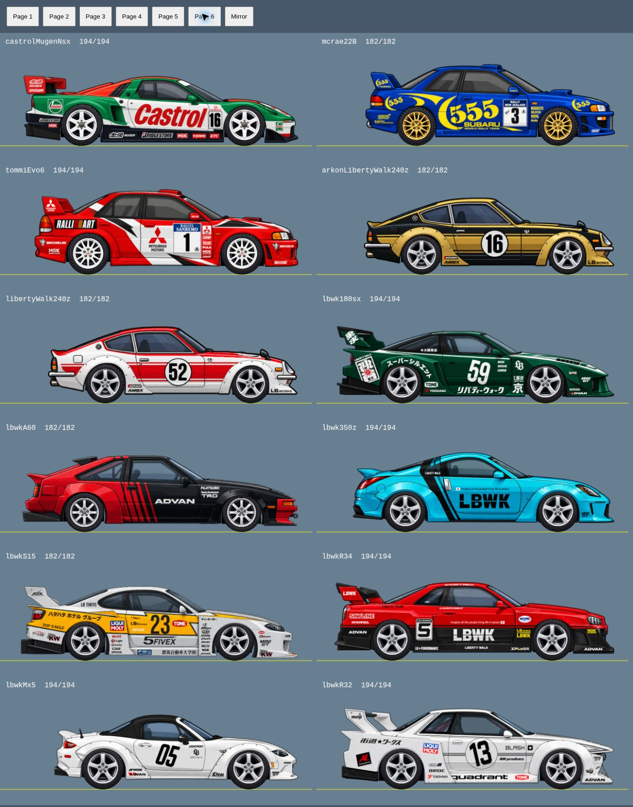

# Wheel visual audit — 29 October 2026

Baseline: main `3eb0eaa` (R718). Reviewed all 72 distinct body paths used by
121 registered cars, including stock, collector, Liberty Walk, crew and demo aliases.
All source car and wheel PNGs, body transforms, mechanical wheel radii, physics,
tuning, AI and save formats are unchanged.

## Corrections

Sizes are visible tyre diameters in source pixels: Small 182, Medium 194, Large 210.
X values are source pixels from the locked PNG right edge. Both tyres retain the
PNG-bottom road contact line.

| Car | Change |
| --- | --- |
| Galant VR-4 | Both tyres Small → Medium |
| Stock S2000 | Both tyres Small → Medium |
| GF8 WRX | Rear/front X −991/−247 → −989/−242 |
| Esprit NSX | Both tyres Small → Medium |
| Amuse S2000 GT1 | Front tyre Small → Medium |
| LBWK 180SX | Rear/front X −985/−325 → −980/−320 |
| LBWK A60 | Rear/front X −967/−246 → −986/−262; both tyres Medium → Small |
| LBWK 350Z | Rear/front X −971/−280 → −966/−263 |
| LBWK S15 | Rear/front X −975/−284 → −982/−294 |
| LBWK R34 | Rear/front X −1010/−276 → −1026/−289 |
| LBWK R32 | Rear/front X −969/−262 → −984/−247 |
| Aruken black/gold 240Z | Rear/front X −887/−224 → −891/−218; shared by Ginza one-off |
| Career white/red 240Z | Rear/front X −887/−224 → −890/−220 |

All other geometry retained after inspection; these cars still receive the shared
arch shadow treatment.

## Wheel-well shadows

A cached Phaser canvas texture traces the body/paint alpha silhouette around
each axle. It fills the open cavity behind the tyre, stops above the road and
adjacent sill, and does not fill unrelated bumper recesses. The shadow follows
the exact body origin, scale, mirror, motion and lifecycle; it is never tinted
or rotated with the wheel. Tyre backing/contact radii are not enlarged.
Magazine and story lists preserve depth order when inserted into containers.

## Verification

- Six Phaser roster pages inspected at runtime, covering every distinct body.
- Liberty Walk page also inspected mirrored.
- 27 focused tests passed: wheel-visual-audit, car-reference-geometry,
  hero-assets-r525, lbwk-fullworks-r694, ginza-crew-wheel-r588.
- GF8 visual fixture updated and its sprite/alignment test passed.
- The old galant-vr4-r502 suite already has four failures on unmodified main
  (retired Evo III identifiers/engine expectations); unchanged by this work.
- Old dev-tools-assets chapter-menu and GF8 206 kW assertions also fail on
  unmodified main. These unrelated historical assertions were not rewritten.
- QA is a real Phaser shared-renderer roster, not a full mobile/tablet gameplay
  playthrough. Race/garage/shop integration uses their existing shared body stack.

Serve the repository and open `tests/visual/wheel-audit.html` to repeat the review.
The temporary preview vendor file is not part of the change.

